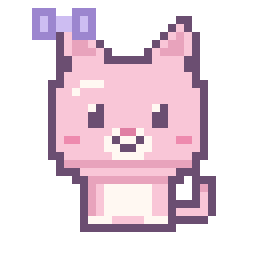

# Focus Buddies

<p align="center">
  
</p>

A cute desktop widget where a pastel pixel art kitten keeps you company while you focus.

Focus Buddies is a small window that stays on top of your work, with a focus timer and a kitten that reacts as your session goes. Later, friends will be able to bring their own pets along for shared study dates.

> **Status:** early development. The solo timer works, and Linux and Windows have releases. Features below may change.

## Install on Linux

Download a file from the [latest release](https://github.com/andvarna99/focus-buddies/releases/latest):

| Your system | File | How to install |
| --- | --- | --- |
| Most Linux systems | `.AppImage` | Run `chmod +x Focus*.AppImage`, then open the file. It may need FUSE. |
| Ubuntu, Debian, Mint | `.deb` | `sudo apt install ./Focus*.deb` |
| Fedora | `.rpm` | `sudo dnf install ./Focus*.rpm` |

These builds aren't signed, and they don't update themselves yet.

## Install on Windows

Download the `-setup.exe` file from the [latest release](https://github.com/andvarna99/focus-buddies/releases/latest) and open it. It works on Windows 10 and 11.

The installer isn't signed, so Windows may show a SmartScreen warning. Choose **More info**, then **Run anyway**. Focus Buddy then appears in the Start menu, and you can uninstall it from **Settings > Apps**. It doesn't update itself yet.

## Development

The app is built with [Tauri 2](https://tauri.app), which targets Linux, Windows, macOS, and iOS from one codebase. On desktop it's a floating widget. On iOS, which doesn't allow apps to float over others, it's a full-screen app. The look comes from `focus-buddy-design-system/`, which is the source of truth for colors, sizes, and sprites.

```bash
npm install
npm run dev        # the interface only, in a browser at http://localhost:1420
npm test
npm run tauri dev  # the real desktop widget
```

The desktop widget needs Node.js 22, Rust, and the [Tauri prerequisites](https://tauri.app/start/prerequisites/) for your system.

### Windows

1. Install [Node.js](https://nodejs.org), [Rust](https://rustup.rs), and the [Microsoft C++ Build Tools](https://visualstudio.microsoft.com/visual-cpp-build-tools/) with **Desktop development with C++**. Windows 10 and 11 normally include WebView2 already.
2. Clone this repo, then run `npm install` and `npm run tauri dev`.

### macOS

1. Install Xcode from the App Store and open it once, then install [Node.js](https://nodejs.org) and [Rust](https://rustup.rs).
2. Clone this repo, then run `npm install` and `npm run tauri dev`.

### iOS

iOS builds need a Mac with Xcode. Running on a real iPhone or iPad also needs an Apple Developer account.

```bash
rustup target add aarch64-apple-ios aarch64-apple-ios-sim
npm run tauri ios init
npm run tauri ios dev
```

Commit the generated `src-tauri/gen/apple` folder afterward.

### What to check on each computer

- The widget fits its window in mini, cozy, and big sizes, with no cut-off edges.
- The corners are see-through.
- You can drag it by the title bar, or by the widget in mini size.
- It stays in front of other windows.
- A finished session chimes and pays 3 treats, and treats are still there after you restart.

## Download a test build

Each push to `main` builds Linux, Windows, and macOS installers. Open the latest run on the repo's **Actions** tab and download them under **Artifacts**. They're kept for 14 days and need a GitHub login.

These test builds aren't signed. Windows may show a SmartScreen warning, where you choose **More info**, then **Run anyway**. On macOS, try to open the app, then choose **Open Anyway** under **System Settings > Privacy & Security**.

## Release a new version

1. Update the version in `package.json`, `src-tauri/Cargo.toml`, and `src-tauri/tauri.conf.json`, then commit.
2. Tag the commit and push the tag:
   ```bash
   git tag v0.2.0
   git push origin v0.2.0
   ```
3. GitHub builds the Linux and Windows files and creates a draft release once both finish. Test the files, then choose **Publish release** on the repo's **Releases** page.

## Planned features

### First version

- **Your kitten:** name your buddy and watch her react as you work.
- **Focus timer:** choose a preset or custom length, with a gentle chime at the end.
- **Breaks:** your kitten stretches, yawns, and reminds you to drink some water.
- **Treats:** finish sessions to earn treats for outfits and room decorations.
- **Always on top:** drag the widget anywhere or tuck it out of the way.

### Later

- **Study dates:** share an invite code to bring a friend's pet into your room.
- **Shared timer:** focus together and earn a bonus for finishing.
- **Tiny reactions:** send a heart or a "you got this!" without opening a chat.
- **Dress-up and rooms:** collect outfits and themes like a bakery or a strawberry cottage.
- **Memory book:** look back on a weekly scrapbook page of your focus time.
- **Ambient sounds:** listen to rain, café chatter, or soft purring.

## Layout

The widget has three sizes, so it only takes up as much room as you need.

| Size | Shows | Used for |
| --- | --- | --- |
| Mini | Your kitten and the timer | Focusing |
| Cozy | Your room, your kitten, friends, the timer controls, and today's totals | Everyday use |
| Dressing room | Tabs for outfits, rooms, friends, and stats | Occasional visits |

## Design

### Principles

- **No guilt:** your kitten never gets sick or dies when you miss a day. If you leave, she naps, and she's happy when you come back.
- **Private by default:** friends see your pet's name and whether you're focusing, never what you're working on.
- **Easy to ignore:** the widget stays quiet and small while you work.

### The kitten

Her starting look is a 32×32 pixel sprite with a big head and tiny body, strawberry-milk fur, a cream belly and paws, rosy cheeks, and a lavender bow.

| Moment | What she does |
| --- | --- |
| Idle | Breathes, blinks, and flicks her tail |
| Focusing | Reads a tiny book in tiny glasses |
| Almost done | Perks up her ears and watches the clock |
| Session finished | Wiggles, hops, and floats pixel hearts |
| Break time | Stretches, yawns, and points to a glass of water |
| You return | Runs over and rubs against the widget's edge |
| Left alone | Curls up and sleeps |

### Art style

The app uses pastel pixel art with soft plum outlines instead of black.

| Role | Color | Hex |
| --- | --- | --- |
| Main pink | Strawberry milk | `#F9C6D7` |
| Secondary | Lavender | `#CDBDF2` |
| Fresh accent | Mint | `#BDEBD6` |
| Warm accent | Butter | `#FFEFB3` |
| Background | Cream | `#FFF8F2` |
| Outlines and text | Plum | `#6B4E71` |

- Keep the whole app to a shared palette of 16 to 24 colors.
- Shade with a tinted color, never gray.
- Scale art by whole numbers only (2×, 3×, 4×), with smoothing turned off.

## Roadmap

1. Draw the kitten's idle sprite and settle the style.
2. Design the cozy view and the mini view.
3. Set up the app with Tauri 2.
4. Build the solo widget with the timer, breaks, and treats.
5. Add outfits and room themes.
6. Add study dates with friends.

## Copyright

Copyright © 2026 Andrea Varnado. All rights reserved.

The app bundles the Pixelify Sans and Nunito fonts under the SIL Open Font License. Their license texts are in `public/licenses/`.
